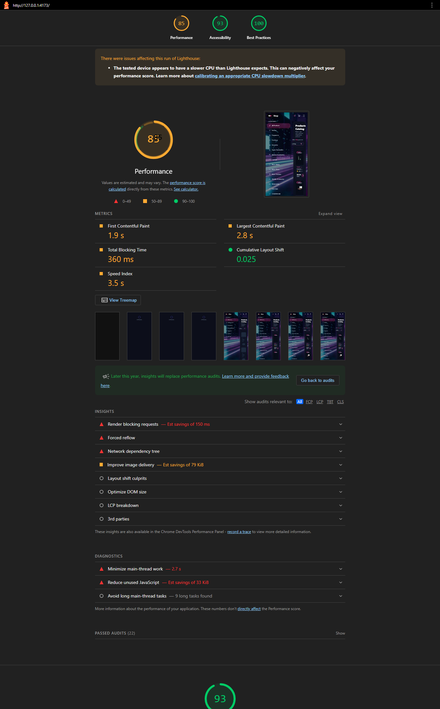
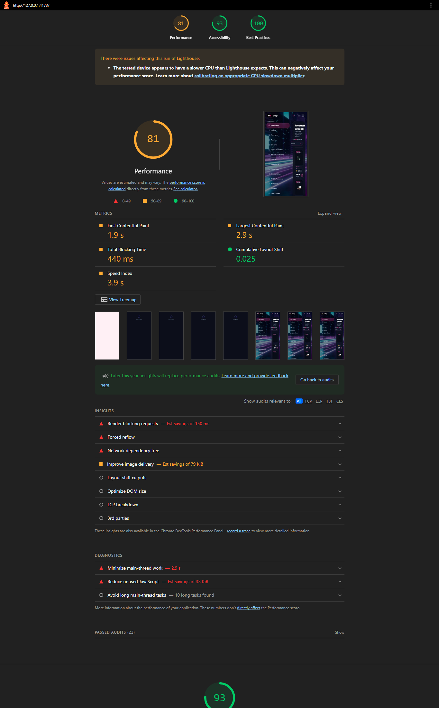

# 10X Shop — Architecture & Technical Report

## 1. Executive Summary
The 10X Shop application is designed with modern React 19 principles, prioritizing component reusability, strict TypeScript type-safety, and single-source-of-truth state management.

## 2. Key Architecture Decisions

### A. Context API for Authentication (`AuthContext`)
- **Problem**: Need to access the authenticated user's state across multiple distant components (Header, LoginPage, CheckoutPage) without prop-drilling.
- **Solution**: Created a centralized `AuthContext` coupled with a custom hook `useAuth()`.
- **Benefit**: Ensures any component can securely read session data or trigger login/logout handlers with zero coupling.

### B. Component Decomposition & DRY Discipline
- **Initial State**: `LoginPage.tsx` originally contained repeated raw `<input>` elements and styling classes, bloating the file to nearly 180 lines.
- **Refactoring Strategy**: Extracted atomic primitives:
  1. `FormField`: Encapsulates label, input, optional indicators (`*`), and validation error feedback.
  2. `Button`: Standardizes primary gradient styling and button behaviors.
  3. `Logo`: Isolates brand vector graphics.
- **Outcome**: Reduced `LoginPage.tsx` complexity by ~65%, achieving clean separation of presentation and validation logic.

## 3. TypeScript Type Discipline
- Strict type definitions (`interface AuthUser`, `interface FormFieldProps`).
- Explicit distinction between mandatory props (`label: string`) and optional props (`type?: string`, `error?: string`).
- Type-safe event signatures (`onChange: (e: React.ChangeEvent<HTMLInputElement>) => void`).

## 4. Product Card Profiling
- **Measurement**: React `Profiler` callbacks around each `ProductCard`, measuring `actualDuration` for one light/dark theme toggle with 12 catalog cards loaded.
- **Environment**: Local Vite development build in Chromium with React Strict Mode; the same catalog data and interaction were used for both runs.
- **Result**:

  | Variant | Cards profiled | Total `actualDuration` |
  | --- | ---: | ---: |
  | `memo(ProductCard)` enabled | 12 | 0.2 ms |
  | `memo(ProductCard)` disabled | 12 | 66.9 ms |

- **Decision**: Keep `memo(ProductCard)`. Theme changes update the catalog page, but the cards' `product` and `onAdd` props remain unchanged, so memoization skips their renders. In this run it reduced card render work by about 99.7%.
- **Limitation**: This is a single local development measurement, not a Lighthouse or production benchmark; `actualDuration` measures React render work, not browser paint or layout.

## 5. Error Boundary Verification
- **Reproduction**: Temporarily rendered a component inside `ErrorBoundary` that throws `Error('Intentional Error Boundary test')` during render, then opened the local app in Chromium.
- **Observed**: The fallback displayed “Something went wrong”, the test error message, and the “Reload Page” button. The browser console also showed the `[ErrorBoundary caught error]` log from `componentDidCatch`.
- **Cleanup**: Removed the temporary throwing component after verification; no test-only trigger remains in the application.

## 6. Lighthouse Before/After
- **Method**: Lighthouse CLI 12.8.2 against the local Vite production preview, Mobile form factor (412 × 823), categories Performance, Accessibility, and Best Practices. This is a local production-build audit, not a deployed-site/incognito audit.
- **Change between runs**: Added preconnect hints for the DummyJSON API and product-image CDN in `index.html`. Lighthouse's preconnect audit changed from failing to passing and estimated about 300 ms saved for the API origin.
- **Results**:

  | Metric | Before | After | What changed |
  | --- | ---: | ---: | --- |
  | Performance | 85 | 81 | Score decreased; not an improvement |
  | Accessibility | 93 | 93 | No score change |
  | Best Practices | 100 | 100 | No score change |
  | First Contentful Paint | 1.9 s | 1.9 s | No measured change |
  | Largest Contentful Paint | 2.8 s | 2.9 s | 0.1 s slower |
  | Total Blocking Time | 360 ms | 440 ms | 80 ms slower |
  | Cumulative Layout Shift | 0.025 | 0.025 | No measured change |

- **Caveat**: Lighthouse warned that this machine's CPU is slower than expected. A repeat after-run scored 79 for Performance, so these single-run timing differences are noisy and do not establish that preconnect caused the score drop. The `uses-rel-preconnect` opportunity was resolved, but the FULL Performance target (≥85) is not confirmed by the after-run. Re-run on the deployed site in an incognito window for the required deployment measurement.
- **Before report**:

  

- **After report**:

  

## 📅 Progress Report — Session Highlights

### 1. Features & Components Implemented
- **Orders History (`/orders`)**:
  - Implemented dynamic order history screen restricted to authenticated users.
  - Added deterministic real-time delivery status timeline based on elapsed time:
    - `0–1 min`: Processing (animated clock)
    - `1–3 min`: Shipped (transit truck badge)
    - `3+ min`: Delivered (success checkmark badge)
  - Extracted modular `OrderCard.tsx` component following Single Responsibility principle.
  - Implemented persistent mock order creation stored in `localStorage`.

- **Global Header Search (`SearchBar.tsx`)**:
  - Built standalone `SearchBar` component embedded within the persistent header.
  - Implemented 400ms debounce navigation that routes external queries directly to catalog (`/?q=...`).

- **Products API Layer (`src/api/products.api.ts`)**:
  - Structured standard `fetchProducts` service connected to DummyJSON API.
  - Implemented pagination math (`skip = (page - 1) * limit`), parameterized search (`?q=`), category filtering (`/category/:slug`), and server sorting with client fallback.
  - Integrated `AbortSignal` support for race-condition prevention.